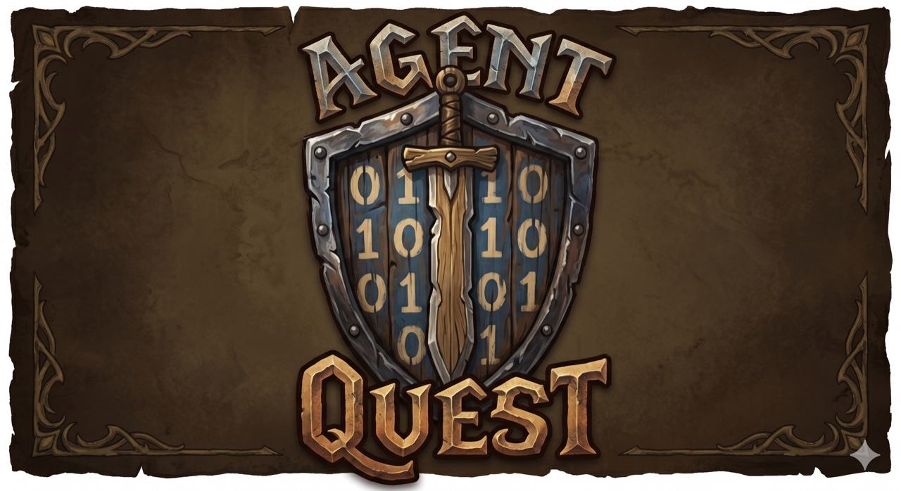
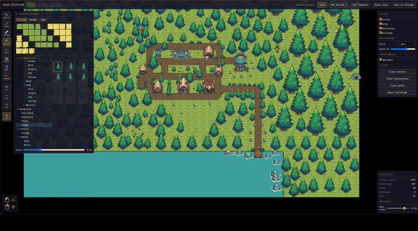
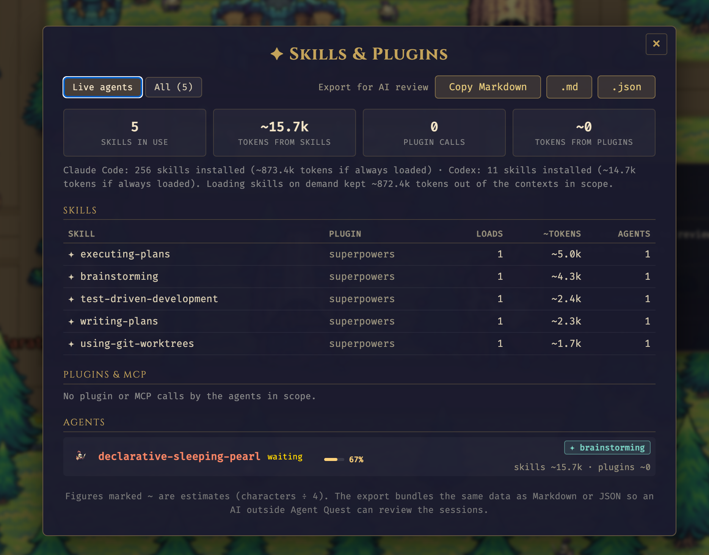
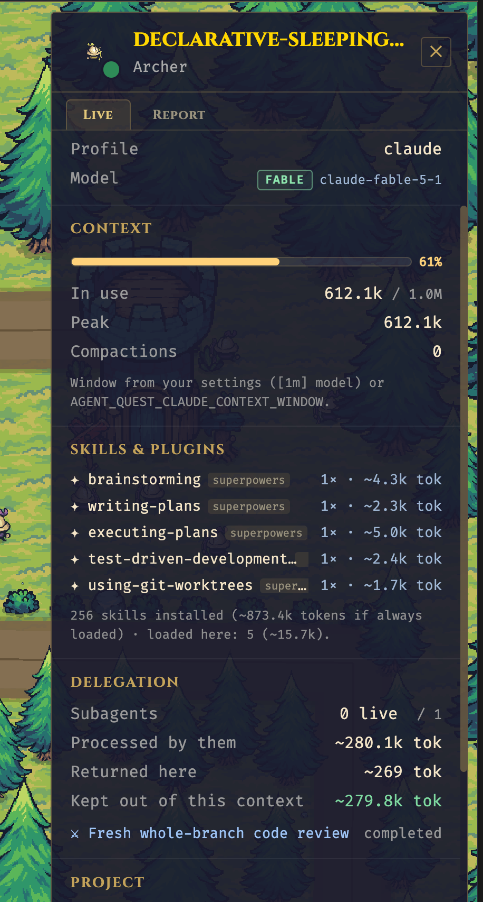
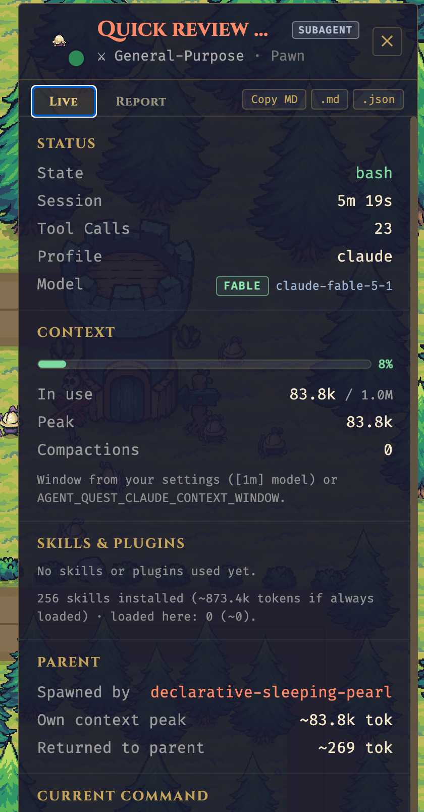

<p align="center">
  
</p>

<p align="center">
  <strong>Claude Code와 Codex를 위한 판타지 마을 대시보드.</strong>
  <br />
  터미널, 앱, IDE 어디서든 에이전트의 활동을 따라가 보세요.
</p>

<p align="center">
  <a href="README.md">English</a> · <strong>한국어</strong>
</p>

<p align="center">
  <a href="#기능"></a>
  <a href="#기능"></a>
</p>

<p align="center">
  <a href="LICENSE"></a>
  <a href="https://bun.sh"></a>
  <a href="https://www.buymeacoffee.com/fulvio"></a>
</p>

<p align="center">
  <a href="https://www.fulvioscichilone.it/agent-quest/"></a>
</p>

---

> **Claude Code나 Codex를 평소처럼 터미널, 앱, IDE에서 사용하세요. 지원되는 로컬 세션 하나하나가 마을의 영웅이 됩니다.**

Agent Quest는 Claude Code와 Codex 세션을 2D 마을 속 판타지 영웅으로 보여 주는 오픈소스 브라우저 대시보드입니다. 로컬 세션 로그를 읽어 터미널, 앱, 호환되는 IDE에서 실행 중인 에이전트를 한눈에 따라갈 수 있습니다.

실행 중인 에이전트는 각각 영웅이 되어 지금 하는 일에 따라 건물 사이를 걸어 다닙니다. `Read`는 도서관으로, `Edit`는 대장간으로, `Bash`는 투기장으로 보내는 식입니다. 또한 영웅마다 컨텍스트 윈도우를 얼마나 썼는지, 어떤 스킬과 플러그인 아래에서 동작하는지, 어떤 서브에이전트가 일하고 있는지 보여 주며, 클릭 한 번으로 세션 요약을 내보내 다른 AI에게 리뷰를 맡길 수도 있습니다.

<p align="center">
  
  <br/>
  <sub><em>영웅 하나가 에이전트 하나입니다. 방문하는 건물이 지금 무엇을 하는지 알려 줍니다.</em></sub>
</p>

<table align="center">
  <tr>
    <td align="center" width="50%">
      
      <br/>
      <sub><em>내장 타일맵 에디터</em></sub>
    </td>
    <td align="center" width="50%">
      
      <br/>
      <sub><em>날씨 효과</em></sub>
    </td>
  </tr>
</table>

<table align="center">
  <tr>
    <td align="center" valign="top" width="54%">
      
      <br/>
      <sub><em>스킬 &amp; 플러그인 — 전체 보기와 AI 리뷰용 내보내기</em></sub>
    </td>
    <td align="center" valign="top" width="23%">
      
      <br/>
      <sub><em>메인 에이전트 — 컨텍스트, 스킬, 위임</em></sub>
    </td>
    <td align="center" valign="top" width="23%">
      
      <br/>
      <sub><em>서브에이전트 — 역할 배지, 부모, 분리된 컨텍스트</em></sub>
    </td>
  </tr>
</table>

## 왜 필요한가요?

Claude Code와 Codex 세션은 터미널, 앱, IDE 곳곳에서 돌아갑니다. 유용하지만 그다지 *살아 있는* 느낌은 아니죠. 여러 에이전트를 동시에 돌리면(여러 프로젝트, 여러 `~/.claude*` 설치, `~/.codex`까지) 실제로 무엇을 하고 있는지 체감하기 어렵습니다. Agent Quest는 눈에 보이지 않던 그 활동을 슬쩍 보기만 해도 알 수 있는 것으로 바꿉니다. 영웅 하나하나가 에이전트인 작은 마을에서, 영웅이 어디로 걸어가는지가 곧 지금 무엇을 하는지를 알려 줍니다.

## 기능

- 활성 Claude Code 및 Codex 세션의 실시간 시각화
- 모든 `~/.claude*` 디렉터리 자동 탐색(`~/.claude-work`, `~/.claude-personale` 같은 다중 설치 지원) 및 `~/.codex`가 있으면 함께 탐색
- 마을 장면 옆에 활동 피드, 파티 바, 상세 패널 제공
- 영웅별 컨텍스트 윈도우 게이지(각 대화가 컴팩션에 얼마나 가까운지), 상단 바에 가장 뜨거운 메인 에이전트 표시, 선택적인 "컨텍스트 거의 가득 참" 알림
- 스킬 & 플러그인 텔레메트리: 영웅이 어떤 스킬 아래에서 동작 중인지, 로드된 스킬이나 플러그인 결과가 컨텍스트에 토큰을 얼마나 밀어 넣었는지, 설치된 스킬을 항상 로드한다면 비용이 얼마나 들지
- 서브에이전트 계층: 기사는 메인 세션, 폰은 서브에이전트입니다. 폰은 부모 색상으로 더 작게 그려지고 `SUBAGENT · role` 배지를 달며, 파티 바에서 부모 아래에 중첩됩니다. 부모 패널에는 위임 덕분에 메인 대화에서 얼마나 많은 컨텍스트를 덜어 냈는지 표시됩니다.
- 다국어 UI: 영어와 한국어가 내장되어 설정에서 전환할 수 있고, JSON 업로드로 빌드 없이 다른 언어를 추가할 수 있습니다.
- 마을 배치를 바꿀 수 있는 내장 맵 에디터
- 2~3초 간격 세션 폴링과 실시간 WebSocket 업데이트(Claude Code `postToolUse` 훅을 통한 저지연 경로는 선택 사항이며 Claude Code 전용입니다. Codex는 훅을 제공하지 않습니다.)
- 레거시 Codex 롤아웃 형식과 Codex ≥ 0.160의 `item_completed` 형식을 모두 지원하며, `spawn_agent`로 생성된 Codex 서브에이전트도 포함

## 요구 사항

**필수**
- [Bun](https://bun.sh) 1.1 이상. 서버와 스크립트 모두 Bun 위에서 동작합니다. 아직 없다면 `curl -fsSL https://bun.sh/install | bash`
- 로컬 세션 로그가 있는 Claude Code 또는 Codex(`~/.claude*`, `~/.codex`, 또는 macOS의 Xcode 에이전트 저장소). 세션 로그가 없어도 대시보드는 켜지지만 마을은 비어 있고 배너가 그 사실을 알려 줍니다.
- 공급자별 OS 지원은 아래 [플랫폼 매트릭스](#플랫폼-매트릭스)를 참고하세요.

**선택**
- [Node.js](https://nodejs.org) 20+ 와 npm. `npm run …` 형태의 명령을 선호할 때만 필요합니다. Bun만 설치되어 있다면 이 README의 모든 `npm run X`는 `bun run X`로 동일하게 실행됩니다.

## 빠른 시작

Agent Quest는 **동등한 두 가지 방법**으로 설치할 수 있습니다. 플랫폼에 맞는 쪽을 고르세요.

- **수동 설치(클래식)** — `git clone` + `bun install` + `bun start`. 명령 세 개로 끝나며 모든 환경(macOS, Linux, WSL2 기반 Windows)에서 동작합니다.
- **한 줄 설치(macOS 전용)** — `curl | bash` 한 줄로 Bun이 없으면 설치하고, 저장소를 클론하고, 의존성을 설치하고, 전역 `agentquest` 명령을 만들고, 앱을 실행합니다.

내부적으로 하는 일은 같습니다. 일상적으로 쓰는 명령은 모두 대응되는 명령이 있습니다.

| CLI 사용 시          | CLI 없이(클래식)                        |
|---------------------|----------------------------------------|
| `agentquest`        | `bun start`                            |
| `agentquest update` | `git pull --ff-only && bun install`    |

`agentquest update`는 `origin/main`을 따라가는 설치본을 쓰는 최종 사용자를 위한 편의 명령입니다. 기능 브랜치에서 작업하는 기여자용 워크플로가 아닙니다.

### 수동 설치

명령 세 개면 됩니다. macOS, Linux, WSL2 기반 Windows에서 동작합니다.

```bash
git clone https://github.com/FulAppiOS/Agent-Quest.git
cd Agent-Quest
bun install
bun start
```

이게 전부입니다. 브라우저가 <http://localhost:4445> 를 열고 마을이 나타납니다.

선택 사항으로, 어느 디렉터리에서든 실행할 수 있도록 `agentquest` 단축 명령을 만들 수 있습니다.

```bash
mkdir -p ~/.local/bin
ln -s "$PWD/bin/agentquest" ~/.local/bin/agentquest
```

심볼릭 링크를 만든 뒤에는 어디서나 `agentquest`(`bun start`의 별칭)와 `agentquest update`(`git pull --ff-only && bun install`의 별칭)를 실행할 수 있습니다.

Agent Quest에는 CC0 픽셀아트 스프라이트 팩이 함께 들어 있어(`client/public/assets/themes/tiny-swords-cc0/`) 따로 내려받을 것이 없습니다.

### 한 줄 설치(macOS 전용)

*한 줄 설치 스크립트는 macOS 전용입니다. Agent Quest 자체는 macOS와 Linux, 그리고 WSL2를 통해 Windows에서도 동작합니다. 위의 수동 설치를 참고하세요.*

```bash
curl -fsSL https://raw.githubusercontent.com/FulAppiOS/Agent-Quest/main/install.sh | bash
```

설치 스크립트는 무엇을 할지 정확히 출력하고, 무언가를 건드리기 전에 먼저 묻습니다. Bun을 확인/설치하고, `~/agent-quest`에 클론하고(`--dir <path>`로 변경 가능), `bun install`을 실행하고, `~/.local/bin/`에 `agentquest` 단축 명령을 만든 다음, 바로 실행할지 묻습니다. 끝나면 브라우저가 <http://localhost:4445> 를 열고 마을이 나타납니다.

다음 세션부터는 이렇게 쓰면 됩니다.

```bash
agentquest            # `agentquest start`와 동일 — 실행 후 브라우저를 엽니다
agentquest update     # git pull + bun install (로컬 맵 편집 내용은 보존)
```

## 릴리스 알림

대시보드는 열릴 때 GitHub에서 최신 정식 릴리스를 확인합니다.
설치된 버전보다 새 버전이 있으면 작은 배너에 사용 가능한 버전, 릴리스 노트,
수동 업데이트 방법이 표시됩니다. 초안, 프리릴리스, 새 릴리스가 없는 커밋은
배너를 띄우지 않습니다.

**내일 다시 알림**을 누르면 해당 릴리스를 브라우저에서 24시간 동안 숨기며,
페이지를 새로 고쳐도 유지됩니다. 그 사이에 더 새로운 릴리스가 나오면 다시 표시될 수
있습니다. 서버는 성공한 확인 결과를 6시간 캐시하고, 실패하면 15분 뒤 다시 시도합니다.
오프라인이거나 GitHub에 접근할 수 없어도 앱 실행은 막히지 않습니다. GitHub 로그인은
필요 없습니다.

업데이트하려면 Ctrl+C로 Agent Quest를 멈추고 `agentquest update`를 실행한 뒤
`agentquest`로 다시 시작하고 대시보드를 새로 고치세요. 수동 설치본이라면 프로젝트 폴더에서
`git pull --ff-only && bun install`을 실행하고 `bun start`로 재시작하면 됩니다.
이 명령들은 `main`을 따라가므로 공지된 릴리스보다 새로운 변경이 포함될 수 있습니다.
업데이트가 자동으로 설치되는 일은 없습니다.

## 컨텍스트, 스킬 & 서브에이전트

모든 영웅은 같은 로컬 로그에서 읽어 낸 세 겹의 추가 텔레메트리를 지니고 있습니다.

| 계층 | 보이는 것 | 출처 |
|---|---|---|
| **컨텍스트 윈도우** | 영웅 위의 막대(초록 → 황색 → 주황 → 빨강, 90%부터 깜빡임), 상단 바의 `Ctx` 수치(가장 뜨거운 메인 대화를 표시하며 클릭하면 모든 활성 메인 에이전트를 비교하는 드롭다운이 열림), 상세 패널의 *Context* 섹션(사용량, 최고치, 컴팩션 횟수) | Claude Code: 모든 어시스턴트 라인의 `message.usage`. Codex: 윈도우 크기까지 알려 주는 `token_count` 이벤트 |
| **스킬 & 플러그인** | 스킬 지침이 적용되는 동안 영웅 위에 뜨는 `✦ skill` 태그, 로드된 모든 스킬(횟수, 주입된 ~토큰)과 호출된 모든 플러그인/MCP 서버(호출 수, 결과 ~토큰)를 나열하는 *Skills & Plugins* 섹션 | Claude Code: `attributionSkill`, `Skill` 도구와 주입된 스킬 본문, MCP 도구 이름과 결과 크기. Codex: `SKILL.md` 읽기와 `McpToolCall` 항목 |
| **서브에이전트** | 기사는 항상 메인 세션입니다. 서브에이전트는 폰(울트라 모드 워크플로 부대는 궁수)으로, 부모 색상으로 더 작게 그려지고 흐린 이탤릭 이름과 `SUBAGENT · role` 배지를 달며, 부모는 `⚑ N` 배지를 답니다. 파티 바에서 부모 아래 중첩되고, 부모의 *Delegation* 섹션에는 서브에이전트가 처리한 컨텍스트와 반환한 양이 비교 표시됩니다. | Claude Code: 트랜스크립트 위치 + `meta.json`. Codex: 롤아웃 헤더의 `parent_thread_id` |
| **전체 보기 & 내보내기** | 상단 바의 `✦` 버튼은 *Skills & Plugins*를 엽니다. 전체 스킬/플러그인 표, 모든 에이전트의 컨텍스트, *Export for AI review*(Markdown 또는 JSON)를 제공합니다. 각 영웅 패널에도 세션 하나짜리 동일한 내보내기가 있습니다. | 같은 데이터를 클라이언트에서 집계 |

내보내기 결과는 Agent Quest 바깥의 다른 AI 세션에 붙여 넣어 에이전트가 컨텍스트를 어떻게 썼는지 리뷰받기 위한 것입니다. 세션 정보, 컨텍스트와 토큰 수치, 활동 분석, 스킬, 플러그인, 위임, 마지막 메시지, 그리고 리뷰 질문 목록이 들어 있습니다. 프롬프트 텍스트와 파일 경로도 포함됩니다.

`~`가 붙은 토큰 수치는 추정치입니다(문자 수 ÷ 4). Claude Code는 컨텍스트 윈도우 크기를
로그에 남기지 않으므로 Agent Quest는 `settings.json`에 설정된 `model`을 읽고(`[1m]` 접미사는
1M 윈도우를 의미), 세션이 200k 토큰을 넘으면 1M으로 추론하며, 그 외에는 200k로 가정합니다.
서버를 시작할 때 `AGENT_QUEST_CLAUDE_CONTEXT_WINDOW=<tokens>`로 덮어쓸 수 있습니다.
컨텍스트 막대와 컨텍스트 알림은 Settings에서 켜고 끌 수 있습니다.

## 언어

대시보드에는 **영어**(기본 언어)와 **한국어**가 내장되어 있습니다. *설정 → 언어*에서 전환할 수 있으며 선택은 브라우저에 저장됩니다.

다른 언어를 추가할 때 코드를 건드릴 필요가 없습니다.

1. *설정 → 언어*에서 **영어 템플릿 다운로드**를 누르면 모든 UI 문자열이 담긴 중첩 JSON 파일 `agent-quest.en.json`을 받을 수 있습니다.
2. 키는 그대로 두고 값만 번역합니다. `"meta": { "name": "Deutsch", "code": "de" }`를 넣으면 언어 목록에 이름이 표시되고 올바른 복수형 규칙이 적용됩니다.
3. **번역 JSON 불러오기…**를 눌러 파일을 선택합니다. UI가 즉시 바뀌고, 파일은 브라우저 로컬 저장소에 보관되어 언어 선택 목록에 *사용자 지정* 항목으로 나타납니다.

파일에 없는 키는 영어로 표시되며, 패널에 몇 개의 문자열이 매칭되었는지 표시됩니다. 복수형은 `key_one` / `key_other`(또는 다른 [CLDR 복수형 범주](https://cldr.unicode.org/index/cldr-spec/plural-rules))를 쓰고, 자리 표시자는 `{count}` 형태입니다.

내장 언어는 `client/src/i18n/locales/<code>/*.json`에 있습니다. 새 언어를 기여하려면 `en` 폴더를 복사해 번역한 뒤 `client/src/i18n/index.ts`에 코드를 등록하세요.

## 문제 해결

**`bun: command not found`** — 먼저 Bun을 설치한 뒤 빠른 시작을 다시 실행하세요.

```bash
curl -fsSL https://bun.sh/install | bash
```

**시작 시 `Cannot find module …`** — 의존성이 설치되지 않았습니다. 저장소 루트에서:

```bash
bun install
```

**4444 또는 4445 포트에서 `EADDRINUSE`** — 다른 프로세스가 포트를 쓰고 있습니다. 포트를 비우거나 환경 변수로 포트를 바꾸세요([설정](#설정) 참고). 어떤 프로세스인지 확인하고 종료하려면:

```bash
lsof -ti:4444,4445 | xargs kill -9
```

**설치 후 `agentquest: command not found`** — `~/.local/bin`이 `$PATH`에 없습니다. 추가하세요.

```bash
echo 'export PATH="$HOME/.local/bin:$PATH"' >> ~/.zshrc && source ~/.zshrc
```

**마을이 비어 있고 "No Claude Code or Codex installation detected" 배너가 보임** — Claude, Codex, 또는 지원되는 Xcode 세션 저장소가 감지되지 않았을 때의 정상 동작입니다. Claude Code나 Codex 세션을 시작하면 영웅이 자동으로 나타납니다(배너는 저절로 사라집니다).

**Xcode 에이전트가 보이지 않음(macOS)** — Xcode 안에서 Claude Agent 또는 Codex를 선택하고 새 프롬프트를 보내세요. Agent Quest는 다음 로컬 위치를 자동으로 감시합니다.

- `~/Library/Developer/Xcode/CodingAssistant/ClaudeAgentConfig/projects`
- `~/Library/Developer/Xcode/CodingAssistant/codex/sessions`

Agent Quest는 Xcode와 같은 macOS 계정으로 실행해야 합니다. 새 활동은 보통 2~3초 폴링 간격 안에 나타나며, 새로 생성된 소스도 이미 열려 있는 대시보드에 반영됩니다. 오래된 체크아웃을 업그레이드했다면 서버를 한 번 재시작하세요. 해당 폴더가 존재하고 읽을 수 있는 `.jsonl` 로그가 들어 있는지 확인하세요. Xcode는 첫 에이전트 세션 이후에야 폴더를 만들 수 있습니다. 3시간보다 오래된 파일은 시작 시 건너뛰고 세션이 재개되면 다시 읽습니다. Xcode 세션에는 선택 사항인 터미널 Claude 훅이 필요 없습니다.

지원 범위는 증분 도구 이벤트를 포함한 호환 로컬 Claude/Codex 로그에 기반합니다. 모든 Xcode 채팅 공급자를 탐지하거나 에이전트의 로그인 상태를 추론하지는 않습니다. 터미널 세션에서 Xcode 도구를 사용해도 그 세션의 소스 라벨은 터미널로 유지됩니다.

**에셋이 깨져 보이거나 부팅 시 "missing asset" 화면에서 멈춤** — [누락된 에셋](#누락된-에셋)을 참고하세요.

## 설정

- `AGENT_QUEST_CLAUDE_CONTEXT_WINDOW` — `settings.json`의 `[1m]` 힌트가 환경에 맞지 않을 때 Claude 컨텍스트 윈도우 크기를 토큰 단위로 강제합니다(예: `1000000`). Codex는 자체 윈도우를 보고하므로 이 값을 무시합니다.

기본값으로 바로 동작합니다. 포트나 URL을 바꾸려면 예제 env 파일을 복사하세요.

```bash
cp server/.env.example server/.env
cp client/.env.example client/.env
```

| 변수 | 위치 | 기본값 | 용도 |
|---|---|---|---|
| `PORT` | server | `4444` | HTTP + WebSocket 포트 |
| `CLIENT_URL` | server | `http://localhost:4445` | CORS 오리진 |
| `CLIENT_PORT` | client | `4445` | Vite 개발 서버 포트 |
| `VITE_SERVER_URL` | client | `http://localhost:4444` | 서버 HTTP 기본 주소 |
| `VITE_WS_URL` | client | `ws://localhost:4444/ws` | 서버 WebSocket URL |

## 개발

```bash
npm start              # 서버 + 클라이언트 동시 실행      (또는: bun start)
npm run dev:server     # 서버만 (:4444)                   (또는: bun run dev:server)
npm run dev:client     # 클라이언트만 (:4445)             (또는: bun run dev:client)
npm run check:assets   # 번들된 스프라이트가 모두 있는지 확인 (또는: bun run check:assets)
cd server && bun test  # 서버 테스트 실행
```

`main`을 따라가는 최종 사용자 설치본에서는 `agentquest update`가 로컬 맵 편집 내용을 보존하면서 `git pull --ff-only && bun install`에 해당하는 작업을 수행합니다. 기능 브랜치에서 작업하는 기여자는 일반 Git 명령을 사용하세요.

### 누락된 에셋

`client/public/assets/themes/tiny-swords-cc0/` 아래의 파일(영웅 스프라이트시트, 건물 PNG, 지형, 장식)을 실수로 지우거나 옮기면 Agent Quest가 알려 줍니다.

- **메인 앱**은 부팅 시 멈추고, 누락된 파일을 범주별(영웅 / 건물 / 지형 / 장식)로 나열하며 복구 명령을 제안하는 화면을 표시합니다.
- **맵 에디터**는 상단에 같은 내용을 담은 닫을 수 있는 배너를 표시합니다. 에디터는 계속 사용할 수 있습니다.
- 언제든 `bun run check:assets`를 실행해 앱을 시작하기 전에 번들 팩 전체를 검증할 수 있습니다. 누락이 있으면 상세 목록과 함께 0이 아닌 종료 코드를 반환하므로 CI나 pre-commit에 쓰기 좋습니다.

복구 방법:

```bash
git checkout -- client/public/assets/themes/tiny-swords-cc0/
```

## LAN 접속(휴대폰 / iPad에서 보기)

보안을 위해 개발 서버는 기본적으로 `localhost`에서만 수신합니다. 같은 Wi-Fi에 있는 다른 기기(휴대폰, 태블릿, 다른 노트북)와 마을을 공유하려면 환경 변수 하나로 켤 수 있습니다.

```bash
# macOS / Linux — 이번 실행에만 적용
AGENT_QUEST_LAN=1 agentquest          # (또는: AGENT_QUEST_LAN=1 bun start)

# 영구 적용 — 한 번 정해 두고 `agentquest`만 실행
echo "AGENT_QUEST_LAN=1" >> ~/agent-quest/server/.env
echo "AGENT_QUEST_LAN=1" >> ~/agent-quest/client/.env
agentquest
```

이 README에 적힌 모든 환경 변수는 `agentquest`에서도 똑같이 동작합니다. 명령 앞에 붙이거나, 두 `.env` 파일에 추가해 영구적으로 적용하면 됩니다.

시작할 때 서버가 접속 가능한 LAN URL을 출력합니다. 예:

```
[Server] LAN mode enabled — reachable from other devices at:
[Server]   http://192.168.1.42:4444 (API)  |  http://192.168.1.42:4445 (UI)
```

다른 기기에서 UI URL을 여세요. 클라이언트가 호스트를 자동 감지하므로 API와 WebSocket 호출이 같은 Mac으로 갑니다. 처음에는 macOS가 들어오는 연결을 허용할지 묻습니다. **허용**을 누르세요.

> **보안 참고.** LAN 모드는 에이전트의 도구 호출, 파일 경로, 명령 출력을 같은 네트워크의 모든 사람에게 노출합니다. 집에서는 괜찮지만 사무실 / 카페 / 컨퍼런스 Wi-Fi에서는 한 번 더 생각하세요.

## 플랫폼 매트릭스

|             | macOS | Windows              | Linux |
|-------------|-------|----------------------|-------|
| Claude Code | ✓     | ✓ (WSL2 권장)         | ✓     |
| Codex       | ✓     | 아직 검증되지 않음      | 아직 검증되지 않음 |
| Xcode Claude / Codex | ✓ | — | — |

Claude Code는 macOS와 Windows(WSL2)에서 검증했습니다. Codex는 지금까지 macOS에서만 테스트했습니다. 공급자가 `~/.codex/sessions/`를 감시하는 방식이므로 Windows/Linux에서도 같은 방식으로 동작할 것으로 예상하지만 아직 확인하지 못했습니다.

## Windows

Bun은 Windows(1.1+)를 공식 지원하지만, 이 프로젝트는 네이티브 Windows에서 검증하지 않으며 개발 도구 쪽에 몇 가지 엣지 케이스가 있습니다(특정 경로에서의 파일 감시, spawn 동작). Windows에서 매끄럽게 쓰려면 **WSL2** 안에서 Agent Quest를 실행하세요.

1. [Microsoft 가이드](https://learn.microsoft.com/ko-kr/windows/wsl/install)를 따라 WSL2를 설치합니다(관리자 PowerShell에서 `wsl --install` 한 줄).
2. WSL2 셸(기본은 Ubuntu)을 열고 Bun을 설치합니다.

   ```bash
   curl -fsSL https://bun.sh/install | bash
   ```

3. WSL2 셸 안에서 위의 [수동 설치](#수동-설치) 단계를 따릅니다. 한 줄 설치 스크립트는 macOS 전용입니다.

네이티브 Windows(PowerShell / cmd.exe)도 이 프로젝트의 크로스 플랫폼 셸 수정 이후 동작할 것으로 보이지만 정기적으로 테스트하지는 않습니다. Windows 전용 문제를 만나면 이슈를 열어 주세요. 풀 리퀘스트도 환영합니다.

## 기여하기

이슈와 풀 리퀘스트를 환영합니다. 버그 리포트, 기능 아이디어, 새 건물 스프라이트, 추가 영웅 클래스 등 무엇이든 좋습니다. 짧은 안내는 [`CONTRIBUTING.ko.md`](CONTRIBUTING.ko.md)를 참고하세요.

## 후원

Agent Quest 덕분에 에이전트들이 조금 더 살아 있는 느낌이 든다면 맥주 한 잔은 언제나 환영입니다 🍺. 한 잔 한 잔이 업데이트를 이어 가는 힘이 됩니다.

<p align="left">
  <a href="https://www.buymeacoffee.com/fulvio"></a>
</p>

## 크레딧

- 스프라이트, 타일, 장식: Pixel Frog의 [Tiny Swords](https://pixelfrog-assets.itch.io/tiny-swords). [CC0 1.0 Universal](client/public/assets/themes/tiny-swords-cc0/LICENSE.txt)(퍼블릭 도메인 헌정) 라이선스. `client/public/assets/themes/tiny-swords-cc0/`에 번들되어 있습니다.

## 라이선스

[MIT](LICENSE) © [Fulvio Scichilone](https://github.com/FulAppiOS)
