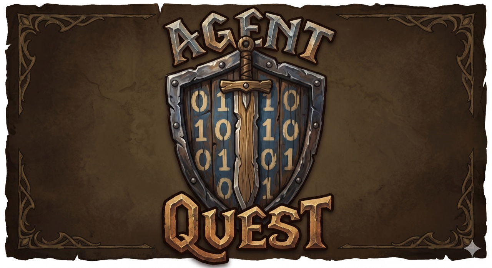
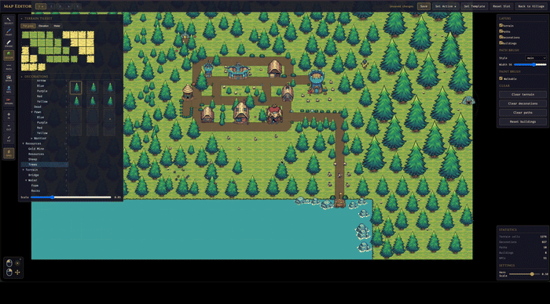
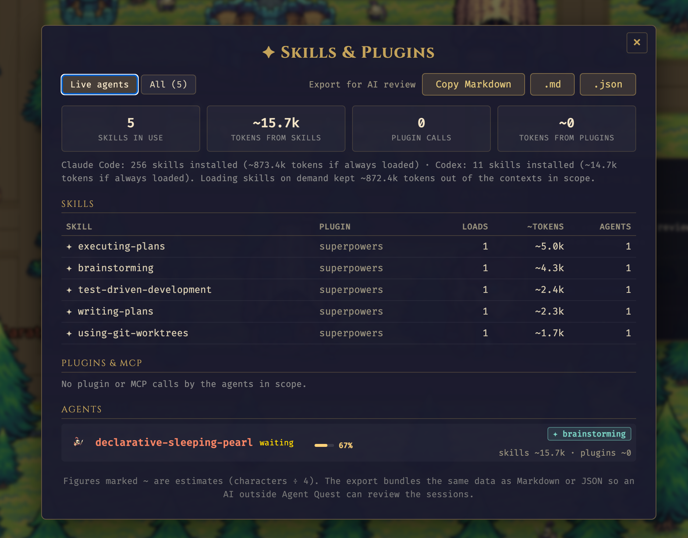
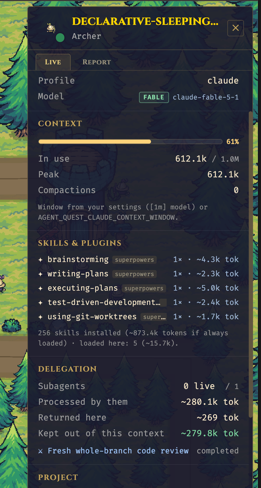
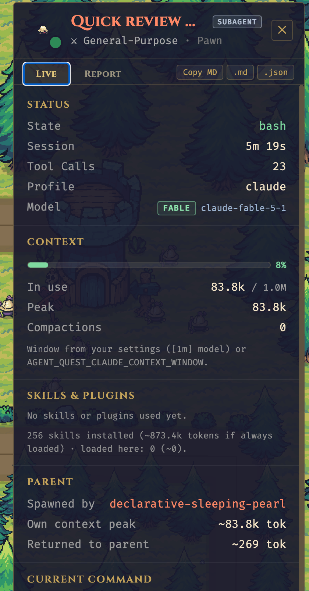

<p align="center">
  
</p>

<p align="center">
  <strong>A fantasy village dashboard for monitoring your Claude Code CLI and Codex agents.</strong>
</p>

<p align="center">
  <a href="LICENSE"></a>
  <a href="https://bun.sh"></a>
  <a href="https://www.buymeacoffee.com/fulvio"></a>
</p>

<p align="center">
  <a href="https://www.fulvioscichilone.it/agent-quest/">Website</a>
</p>

---

> **Use Claude Code CLI or Codex as usual — each agent session auto-spawns a hero on the dashboard, live.**

Agent Quest is a browser-based monitoring dashboard that visualizes active Claude Code and Codex agent sessions as fantasy heroes in a 2D village. Each running agent becomes a hero who walks between buildings based on what it's doing: `Read` sends it to the Library, `Edit` to the Forge, `Bash` to the Arena, and so on. Every hero also shows how much of its context window it has used, which skills and plugins it is running under, and which subagents are working for it — with a one-click export you can hand to another AI to review the session.

<p align="center">
  
  <br/>
  <sub><em>Every hero is an agent — the building it visits tells you what it's doing.</em></sub>
</p>

<table align="center">
  <tr>
    <td align="center" width="50%">
      
      <br/>
      <sub><em>Integrated Tile Map Editor</em></sub>
    </td>
    <td align="center" width="50%">
      
      <br/>
      <sub><em>Weather effects</em></sub>
    </td>
  </tr>
</table>

<table align="center">
  <tr>
    <td align="center" valign="top" width="54%">
      
      <br/>
      <sub><em>Skills &amp; Plugins — fleet view and AI-review export</em></sub>
    </td>
    <td align="center" valign="top" width="23%">
      
      <br/>
      <sub><em>Main agent — context, skills, delegation</em></sub>
    </td>
    <td align="center" valign="top" width="23%">
      
      <br/>
      <sub><em>Subagent — role badge, parent, context kept out</em></sub>
    </td>
  </tr>
</table>

## Why?

Claude Code and Codex sessions happen in a terminal — useful, but not very *alive*. When you run several agents at once (across projects, across `~/.claude*` installations and `~/.codex`), it's hard to feel what they're actually doing. Agent Quest turns that invisible activity into something you can glance at: a little village where every hero is an agent, and where they walk tells you what they're up to.

## Features

- Real-time visualization of active Claude Code and Codex sessions
- Auto-discovery of every `~/.claude*` directory (supports multiple installations like `~/.claude-work`, `~/.claude-personale`) and of `~/.codex` if present
- Activity feed, party bar, and detail panel alongside the village scene
- Context-window gauge per hero (how close each conversation is to a compaction), plus the hottest main agent in the top bar and an optional "context nearly full" alert
- Skill & plugin telemetry: which skill a hero is running under, how many tokens each loaded skill or plugin result pushed into the context, and what the installed skills would cost if they were always loaded
- Subagent hierarchy: knights are main sessions, pawns are subagents — smaller, in the parent's color with a `SUBAGENT · role` badge; they nest under the parent in the party bar, and the parent's panel shows how much context delegation kept out of the main conversation
- Built-in map editor for customizing the village layout
- Sub-2s latency via native WebSocket (optional lower-latency path via Claude Code `postToolUse` hooks — Claude Code only; Codex doesn't expose hooks)
- Works with both the legacy Codex rollout format and the `item_completed` format of Codex ≥ 0.160, including Codex subagents spawned with `spawn_agent`

## Requirements

**Required**
- [Bun](https://bun.sh) 1.1 or later — the runtime behind both the server and the scripts. If you don't have it: `curl -fsSL https://bun.sh/install | bash`
- An active Claude Code or Codex installation (one or more `~/.claude*` directories, and/or `~/.codex`, with session logs). Without either, the dashboard still starts, but the village stays empty and a banner tells you so.
- See the [Platform matrix](#platform-matrix) below for OS support per provider.

**Optional**
- [Node.js](https://nodejs.org) 20+ with npm — only if you prefer the `npm run …` command form. If you only have Bun installed, every `npm run X` in this README has an equivalent `bun run X`.

## Quick start

Agent Quest can be set up in **two equivalent ways** — pick the one that matches your platform:

- **Manual install (classic)** — `git clone` + `bun install` + `bun start`. Three commands, full control, works everywhere (macOS, Linux, Windows via WSL2).
- **One-line install (macOS only)** — a single `curl | bash` that installs Bun if missing, clones the repo, installs dependencies, creates a global `agentquest` command, and launches the app.

They do the same work under the hood. Every daily command has an equivalent:

| With the CLI        | Without (classic)                      |
|---------------------|----------------------------------------|
| `agentquest`        | `bun start`                            |
| `agentquest update` | `git pull --ff-only && bun install`    |

`agentquest update` is a convenience command for end users running an installed copy that tracks `origin/main`. It is not the contributor workflow for feature branches.

### Manual install

Three commands — works on macOS, Linux, and Windows via WSL2:

```bash
git clone https://github.com/FulAppiOS/Agent-Quest.git
cd Agent-Quest
bun install
bun start
```

That's it: your browser opens on <http://localhost:4445> and the village appears.

Optional — create an `agentquest` shortcut so you can launch from any directory:

```bash
mkdir -p ~/.local/bin
ln -s "$PWD/bin/agentquest" ~/.local/bin/agentquest
```

After the symlink you can run `agentquest` (alias of `bun start`) and `agentquest update` (alias of `git pull --ff-only && bun install`) from anywhere.

Agent Quest ships with a bundled CC0 pixel-art sprite pack (under `client/public/assets/themes/tiny-swords-cc0/`), so there's nothing else to download.

### One-line install (macOS only)

*The one-line installer script is macOS-only; Agent Quest itself runs on macOS and Linux, and via WSL2 on Windows — see the manual install above.*

```bash
curl -fsSL https://raw.githubusercontent.com/FulAppiOS/Agent-Quest/main/install.sh | bash
```

The installer prints exactly what it's going to do and asks before touching anything. It checks/installs Bun, clones into `~/agent-quest` (override with `--dir <path>`), runs `bun install`, creates an `agentquest` shortcut in `~/.local/bin/`, and offers to launch right away. When it finishes, your browser opens on <http://localhost:4445> and the village appears.

From the next session onwards:

```bash
agentquest            # same as `agentquest start` — launches and opens the browser
agentquest update     # git pull + bun install (preserves local map edits)
```

## Context, skills & subagents

Every hero carries three extra layers of telemetry, all read from the same local logs:

| Layer | What you see | Where it comes from |
|---|---|---|
| **Context window** | A bar above the hero (green → amber → orange → red, pulsing from 90%), a `Ctx` stat in the top bar showing the hottest main conversation (click it to open a dropdown comparing every live main agent), and a *Context* section in the detail panel with usage, peak and compaction count | Claude Code: `message.usage` of every assistant line. Codex: `token_count` events, which also report the window size |
| **Skills & plugins** | A `✦ skill` tag above the hero while a skill's instructions apply; a *Skills & Plugins* section listing every skill loaded (how many times, ~tokens injected) and every plugin / MCP server called (calls, ~tokens of results) | Claude Code: `attributionSkill`, the `Skill` tool and the injected skill body; MCP tool names and result sizes. Codex: `SKILL.md` reads and `McpToolCall` items |
| **Subagents** | Knights are always main sessions; subagents are pawns (archers for ultra-mode workflow squads), drawn smaller in the parent's color with a dimmer italic name and a `SUBAGENT · role` badge, while the parent wears a `⚑ N` badge. They nest in the party bar, and the parent's *Delegation* section shows the context processed by the subagents vs. what they returned | Claude Code: transcript location + `meta.json`. Codex: `parent_thread_id` in the rollout header |
| **Fleet view & export** | The `✦` button in the top bar opens *Skills & Plugins*: fleet-wide skill and plugin tables, every agent's context, and *Export for AI review* (Markdown or JSON). Each hero's panel has the same export for one session | Aggregated client-side from the same data |

The export is meant to be pasted into another AI session (outside Agent Quest) so it can review how an agent spent its context: it contains the session facts, context and token figures, activity breakdown, skills, plugins, delegation, the last message and a list of review questions. Prompt text and file paths are included.

Token figures marked `~` are estimates (characters ÷ 4). Claude Code never writes the context
window size to its logs, so Agent Quest reads the `model` configured in your `settings.json`
(a `[1m]` suffix means the 1M window), infers 1M once a session exceeds 200k tokens, and
otherwise assumes 200k. Override it with `AGENT_QUEST_CLAUDE_CONTEXT_WINDOW=<tokens>` when
starting the server. Context bars and the context alert can be toggled in
Settings.

## Troubleshooting

**`bun: command not found`** — install Bun first, then re-run the Quick start:

```bash
curl -fsSL https://bun.sh/install | bash
```

**`Cannot find module …` on startup** — dependencies weren't installed. From the repo root:

```bash
bun install
```

**`EADDRINUSE` on port 4444 or 4445** — another process holds the port. Either free it or override the port via env (see [Configuration](#configuration)). To see what is holding it and kill it:

```bash
lsof -ti:4444,4445 | xargs kill -9
```

**`agentquest: command not found` after install** — `~/.local/bin` is not in your `$PATH`. Add it:

```bash
echo 'export PATH="$HOME/.local/bin:$PATH"' >> ~/.zshrc && source ~/.zshrc
```

**Empty village with a "No Claude Code or Codex installation detected" banner** — expected when no `~/.claude*` or `~/.codex` directory with session logs exists. Start a Claude Code or Codex session and heroes appear automatically (the banner disappears on its own).

**Assets look broken or the app blocks at boot with "missing asset" screens** — see [Missing assets](#missing-assets).

## Configuration

- `AGENT_QUEST_CLAUDE_CONTEXT_WINDOW` — force the Claude context window size in tokens (e.g. `1000000`) when the `[1m]` hint in `settings.json` doesn't apply to your setup. Codex reports its own window and ignores this.

Defaults work out of the box. To customize ports or URLs, copy the example env files:

```bash
cp server/.env.example server/.env
cp client/.env.example client/.env
```

| Variable | Where | Default | Purpose |
|---|---|---|---|
| `PORT` | server | `4444` | HTTP + WebSocket port |
| `CLIENT_URL` | server | `http://localhost:4445` | CORS origin |
| `CLIENT_PORT` | client | `4445` | Vite dev server port |
| `VITE_SERVER_URL` | client | `http://localhost:4444` | Server HTTP base |
| `VITE_WS_URL` | client | `ws://localhost:4444/ws` | Server WebSocket URL |

## Development

```bash
npm start              # server + client concurrently   (or: bun start)
npm run dev:server     # server only (:4444)            (or: bun run dev:server)
npm run dev:client     # client only (:4445)            (or: bun run dev:client)
npm run check:assets   # verify every bundled sprite is on disk (or: bun run check:assets)
cd server && bun test  # run server tests
```

For installed end-user copies that follow `main`, `agentquest update` runs the equivalent of `git pull --ff-only && bun install` while preserving local map edits. Contributors on feature branches should use normal Git commands instead.

### Missing assets

If you accidentally delete or move files under `client/public/assets/themes/tiny-swords-cc0/` (hero spritesheets, building PNGs, terrain, decorations), Agent Quest will tell you:

- The **main app** blocks at boot with a screen that lists the missing files grouped by category (hero / building / terrain / decoration) and suggests a restore command.
- The **map editor** shows a dismissible banner at the top with the same breakdown — the editor stays usable so you can keep working.
- Run `bun run check:assets` any time to verify the whole bundled pack ahead of starting the app. Exits non-zero with a detailed list if anything is missing — good for CI or pre-commit.

Restore with:

```bash
git checkout -- client/public/assets/themes/tiny-swords-cc0/
```

## LAN access (view from your phone / iPad)

By default the dev servers only listen on `localhost` for security. To share the village with other devices on the same Wi-Fi (phone, tablet, another laptop), opt in with a single env flag:

```bash
# macOS / Linux — one-off, for this run only
AGENT_QUEST_LAN=1 agentquest          # (or: AGENT_QUEST_LAN=1 bun start)

# Permanent — decide once, then just run `agentquest`
echo "AGENT_QUEST_LAN=1" >> ~/agent-quest/server/.env
echo "AGENT_QUEST_LAN=1" >> ~/agent-quest/client/.env
agentquest
```

Any env var documented in this README works identically with `agentquest` — just prefix it on the command line, or add it to the two `.env` files for a persistent choice.

At startup the server prints reachable LAN URLs, for example:

```
[Server] LAN mode enabled — reachable from other devices at:
[Server]   http://192.168.1.42:4444 (API)  |  http://192.168.1.42:4445 (UI)
```

Open the UI URL on the other device. The client auto-detects the host so API and WebSocket calls go to the same Mac. The first time, macOS asks to allow incoming connections — click **Allow**.

> **Security note.** LAN mode exposes your agents' tool calls, file paths and command output to anyone on the same network. Fine at home; think twice on office / café / conference Wi-Fi.

## Platform matrix

|             | macOS | Windows              | Linux |
|-------------|-------|----------------------|-------|
| Claude Code | ✓     | ✓ (WSL2 recommended) | ✓     |
| Codex       | ✓     | not yet verified     | not yet verified |

Claude Code is exercised on macOS and Windows (via WSL2). Codex has been tested on macOS only so far — it should work on Windows/Linux the same way (the provider watches `~/.codex/sessions/`), but we haven't confirmed it yet.

## Windows

Bun officially supports Windows (1.1+), but we don't exercise this project on native Windows and a few dev-tool edge cases exist (file watching under certain paths, spawn semantics). For a frictionless experience on Windows, run Agent Quest inside **WSL2**:

1. Install WSL2 following [Microsoft's guide](https://learn.microsoft.com/en-us/windows/wsl/install) (one command: `wsl --install` in an admin PowerShell).
2. Open your WSL2 shell (Ubuntu by default) and install Bun:

   ```bash
   curl -fsSL https://bun.sh/install | bash
   ```

3. Follow the [Manual install](#manual-install) steps above, inside the WSL2 shell. The one-line installer is macOS-only.

Native Windows (PowerShell / cmd.exe) should also work after this project's cross-platform shell fixes, but isn't routinely tested. If you hit a Windows-only issue, please open a ticket — pull requests welcome.

## Contributing

Issues and pull requests are welcome — bug reports, feature ideas, new building sprites, extra hero classes, anything. See [`CONTRIBUTING.md`](CONTRIBUTING.md) for the short version.

## Support

If Agent Quest makes your agents feel a little more alive, a beer is always welcome 🍺 — every one helps keep the updates flowing.

<p align="left">
  <a href="https://www.buymeacoffee.com/fulvio"></a>
</p>

## Credits

- Sprites, tiles, and decorations: [Tiny Swords](https://pixelfrog-assets.itch.io/tiny-swords) by Pixel Frog — licensed [CC0 1.0 Universal](client/public/assets/themes/tiny-swords-cc0/LICENSE.txt) (public domain dedication). Bundled under `client/public/assets/themes/tiny-swords-cc0/`.

## License

[MIT](LICENSE) © [Fulvio Scichilone](https://github.com/FulAppiOS)
